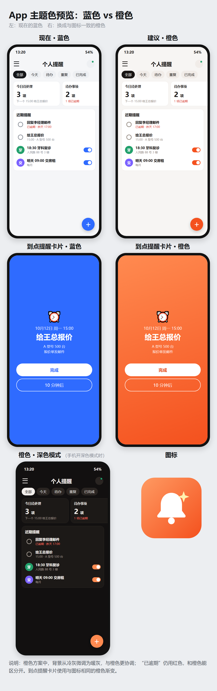

<p align="center">
  
</p>

<h1 align="center">醒达 Remindar</h1>

<p align="center">
  到点像闹钟一样叫醒你的个人提醒 + 待办 App，<br>
  粘贴短信或用语音一句话即可由大模型自动建提醒，<br>
  在家找不到手机时，电脑或家人手机一点就能让它响铃（静音也响）。
</p>

<p align="center">
  <b>Remindar</b> = Remind + Radar · Android 7.0+ · Kotlin · 无需自建服务器
</p>

---

## 功能

### ⏰ 到点提醒（像闹钟一样）
- 使用用户的闹钟铃声、闹钟音量持续响铃 + 振动，**静音模式下也会响**，最多 1 分钟
- 锁屏时自动亮屏并弹出全屏卡片：知道了 / 完成 / 10 分钟后
- 使用 `setAlarmClock` 精确定时（实测误差约 0.06 秒），开机、改时间后自动恢复
- 重复：每天 / 每周 / 每月

### ✅ 待办
- 到点提醒后保留，未完成显示红色“已逾期”并置顶
- 列表中点圆圈完成（可撤销），通知上也能直接“完成”
- 逾期待办每天在设定时间静默提醒一次（不响铃，只在通知栏和锁屏显示）

### ✨ 智能识别（大模型）
- 新建提醒时自动粘贴剪贴板中刚复制的短信 / 邮件，并自动识别
- 也可用输入法语音说一句话，如“明天下午三点前给王总报价”
- 从短信、邮件等 App 选中文字 → 分享 →“醒达”，直接识别
- 自动区分**待办**与**日程**，日程可选提前 30 分钟 / 1 小时 / 1 天提醒
- 支持任何 OpenAI 兼容接口，预置通义千问（默认）、DeepSeek、智谱 GLM；API Key 使用 Android Keystore 加密保存
- 识别结果只填入表单，由用户确认后保存

### 📱 查找手机（完全离线）
- 手机在局域网内提供一个极小的网页服务，电脑或家人手机浏览器打开后点按钮即响铃
- 闹钟音频流 + 临时最大音量，静音、勿扰模式下也能响
- 家人扫 App 中的二维码即可使用（PIN 自动填入），并可“添加到主屏幕”
- 路由器断网也能用，不依赖任何服务器或厂商账号；6 位 PIN 保护，连续输错锁定

## 界面

<p align="center">
  
</p>

## 构建

需要 JDK 17 与 Android SDK（compileSdk 34）。

```bash
cd ReminderApp
./gradlew assembleDebug
```

安装包位于 `ReminderApp/app/build/outputs/apk/debug/app-debug.apk`。也可以直接用 Android Studio 打开 `ReminderApp` 目录。

## 首次使用

部分国产系统（ColorOS、MIUI、HarmonyOS 等）对后台管控较严，建议：

1. 允许通知，并在系统通知管理中开启“横幅”“锁屏”
2. 应用管理 → 耗电管理：允许完全后台行为、允许自启动
3. App 内 设置 → 锁屏时弹出全屏提醒：授予“悬浮窗”权限
4. 首次全屏提醒时系统询问“锁屏显示”：允许
5. 使用查找手机时，建议在路由器中为手机绑定固定 IP，家人的链接才不会失效

## 隐私

- 所有提醒数据只保存在手机本地
- 查找手机只在局域网内工作，不经过任何服务器
- 只有点击“识别”时，输入的文字才会发送到你所选的大模型服务商

## 文档

详细设计（架构、数据库、各模块流程、真机适配记录、测试用例）见 [设计说明.md](ReminderApp/设计说明.md)。

## 许可证

[MIT](LICENSE)
